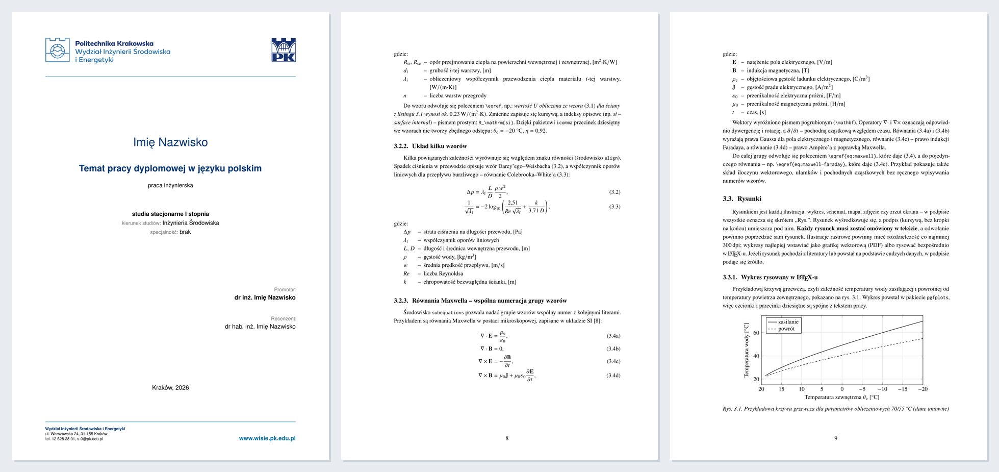

# Formatka pracy dyplomowej w LaTeX-u – WIŚiE PK

Szablon pracy dyplomowej (inżynierskiej i magisterskiej) dla **Wydziału Inżynierii
Środowiska i Energetyki Politechniki Krakowskiej**, przygotowany w LaTeX-u.
Strona tytułowa odwzorowuje wzór wydziałowy, a cała praca jest sformatowana
zgodnie z typowymi wymaganiami edytorskimi: A4, marginesy 3,5/2,5 cm, Times 11 pt,
interlinia 1,25, numeracja rysunków, tabel i wzorów w obrębie rozdziałów.

> **Formatka jest nieoficjalna.** Nie jest dokumentem wydanym przez Politechnikę
> Krakowską. Ostateczne wymagania ustala promotor i dziekanat – przed oddaniem
> pracy sprawdź je, szczególnie treść oświadczenia.



## Co zawiera

- **Stronę tytułową** z oficjalnym logo PK i WIŚiE. Dane pracy wpisuje się raz,
  na górze pliku `strony/tytulowa.tex`.
- **Oświadczenie** o samodzielnym wykonaniu pracy. Formy męskie lub żeńskie
  („uzyskałem/uzyskałam”) i wybór TAK/NIE ustawiają się automatycznie.
- Spis treści, wykaz oznaczeń, spis rysunków, spis tabel i załączniki.
- **Gotowe przykłady**: wzory z objaśnieniami („gdzie: …”), równania Maxwella
  z numeracją grupy i poszczególnych równań (`subequations`), wykresy (pgfplots),
  schematy (TikZ), rysunki z plików, rysunki złożone, tabele z jednostkami
  (siunitx), tabela i wykres wczytywane z pliku CSV z Excela, listingi kodu.
- **Bibliografię** (biblatex + biber) z przykładami: książki, rozdziały,
  artykuły z DOI, referaty, raporty, **normy PN-EN/ISO**, **akty prawne (Dz.U.)**,
  **strony internetowe** z datą dostępu, zbiory danych i oprogramowanie.
- Polską typografię: przecinek dziesiętny we wzorach i na wykresach, jednostki
  w zapisie W/(m²·K), podpisy „Rys.” i „Tabela”.

## Szybki start

1. Zainstaluj MiKTeX i VS Code – [instrukcja poniżej](#instalacja-latexa-miktex-i-vs-code-windows).
2. Pobierz formatkę: przycisk **Use this template** (własne repozytorium),
   **Code → Download ZIP** albo
   `git clone https://github.com/MichalJCw/WISiE_PK_formatka.git`.
3. Otwórz folder formatki w VS Code (**File → Open Folder…**).
4. Uzupełnij dane w pliku `strony/tytulowa.tex`.
5. Skompiluj: **Ctrl+Alt+B**. Powstanie plik `praca.pdf`; podgląd otwiera **Ctrl+Alt+V**.
6. Pisz kolejne rozdziały w folderze `rozdzialy/`, a źródła dopisuj do `literatura.bib`.

## Struktura plików

```text
praca.tex             plik główny – kompiluje się właśnie ten plik
wisiepk.cls           klasa z ustawieniami formatowania (zwykle bez zmian)
literatura.bib        opisy bibliograficzne (z przykładami i pustymi wzorami)
strony/
  tytulowa.tex        DANE PRACY + strona tytułowa
  oswiadczenie.tex    oświadczenie autora
  oznaczenia.tex      wykaz oznaczeń (opcjonalny)
rozdzialy/            rozdziały pracy – jeden plik = jeden rozdział
zalaczniki/           załączniki (A, B, C…)
rysunki/              pliki graficzne
  logo/               oficjalne logo PK i WIŚiE (nie zmieniać nazw plików)
dane/                 pliki CSV wczytywane do tabel i wykresów
kod/                  kody programów wstawiane jako listingi
.vscode/settings.json gotowa konfiguracja LaTeX Workshop
latexmkrc             konfiguracja dla latexmk (opcjonalnie)
```

## Instalacja LaTeX-a (MiKTeX) i VS Code (Windows)

### 1. MiKTeX

1. Pobierz instalator ze strony <https://miktex.org/download> (*Installer* dla Windows).
2. Wybierz instalację **„Only for me”** – nie wymaga uprawnień administratora.
3. Ustaw rozmiar papieru na **A4**.
4. W opcji **„Install missing packages on-the-fly”** wybierz **„Yes”**. Dzięki
   temu brakujące pakiety zostaną pobrane automatycznie przy pierwszej kompilacji.
5. Po instalacji uruchom **MiKTeX Console** → **Updates** → **Check for updates**
   → **Update now**.

Sprawdzenie instalacji – w terminalu (PowerShell lub terminal w VS Code):

```powershell
pdflatex --version
biber --version
```

Jeżeli polecenia nie zostaną znalezione, wyloguj się i zaloguj ponownie do
Windows (albo uruchom komputer ponownie), żeby odświeżyć zmienną PATH.

### 2. VS Code i rozszerzenie LaTeX Workshop

1. Zainstaluj VS Code ze strony <https://code.visualstudio.com>.
2. Otwórz panel rozszerzeń (**Ctrl+Shift+X**), wyszukaj **LaTeX Workshop**
   (autor: James Yu) i kliknij **Install**.
3. Uruchom VS Code ponownie i otwórz folder formatki.

Repozytorium zawiera plik `.vscode/settings.json`, więc nic więcej nie trzeba
konfigurować. Domyślny przepis kompilacji to
**pdflatex → biber → pdflatex → pdflatex** i nie wymaga Perla. Inne przepisy
wybierzesz w panelu **TEX** (ikona na pasku bocznym) → **Build LaTeX project**.

### 3. Pierwsza kompilacja

- Otwórz `praca.tex` i naciśnij **Ctrl+Alt+B** (lub zapisz plik – kompilacja
  uruchomi się sama).
- Pierwsza kompilacja trwa dłużej, bo MiKTeX pobiera brakujące pakiety. Jeśli
  pojawi się okno z pytaniem o instalację pakietu – zatwierdź.
- **Ctrl+Alt+V** otwiera podgląd PDF w karcie obok. **Ctrl+klik** w podglądzie
  przenosi do odpowiedniego miejsca w kodzie, a **Ctrl+Alt+J** – z kodu do PDF.

### 4. Perl (opcjonalnie, tylko dla latexmk)

`latexmk` automatycznie uruchamia kompilację tyle razy, ile potrzeba, ale
w MiKTeX-u wymaga zainstalowanego Perla. Jeśli chcesz z niego korzystać,
zainstaluj [Strawberry Perl](https://strawberryperl.com) i wybierz przepis
**latexmk (wymaga Perla)**. W terminalu wystarczy wtedy polecenie `latexmk`.

### Typowe problemy

| Objaw | Rozwiązanie |
| --- | --- |
| `'pdflatex' is not recognized…` | Uruchom ponownie VS Code lub komputer; sprawdź, czy MiKTeX jest zainstalowany. |
| `script engine 'perl' not found` | Używasz latexmk bez Perla – wybierz domyślny przepis albo zainstaluj Strawberry Perl. |
| Zamiast numerów cytowań widać `[?]` lub pogrubione klucze | Nie uruchomił się biber – użyj pełnego przepisu (z biberem) i skompiluj ponownie. |
| Dziwne błędy po zmianie pakietów | **Ctrl+Alt+C** (usunięcie plików pomocniczych) i kompilacja od nowa. |
| Błąd biber po aktualizacji MiKTeX-a | Zaktualizuj MiKTeX w MiKTeX Console, usuń pliki pomocnicze i skompiluj ponownie. |

### Bez instalacji – Overleaf

Formatkę można też kompilować w przeglądarce: spakuj folder do ZIP, a w
[Overleaf](https://www.overleaf.com) wybierz **New Project → Upload Project**.
W ustawieniach projektu wybierz kompilator **pdfLaTeX**; biber uruchamia się
automatycznie.

### macOS i Linux

Zamiast MiKTeX-a zainstaluj **TeX Live** (Linux, np. pakiet `texlive-full`) lub
**MacTeX** (macOS). Konfiguracja VS Code jest taka sama.

## Jak korzystać z formatki

### Dane pracy

Na górze pliku `strony/tytulowa.tex`:

| Polecenie | Znaczenie |
| --- | --- |
| `\autor{}` | imię i nazwisko autora |
| `\plecautora{}` | `M` lub `K` – formy gramatyczne w oświadczeniu |
| `\tytulPL{}` | temat pracy |
| `\rodzajpracy{}` | `inżynierska` lub `magisterska` |
| `\formastudiow{}` | `stacjonarne` lub `niestacjonarne` |
| `\stopienstudiow{}` | `I` lub `II` |
| `\kierunek{}`, `\specjalnosc{}` | kierunek i specjalność (`brak`, jeśli nie ma) |
| `\promotor{}` | tytuł/stopień, imię i nazwisko promotora |
| `\recenzent{}` | recenzent; puste pole ukrywa ten wiersz |
| `\miejsce{}`, `\rok{}` | miejsce i rok na dole strony tytułowej |
| `\zgodaASAP{}` | `TAK` lub `NIE` – zgoda na udostępnienie pracy w ASAP |

Podczas kompilacji formatka ostrzega w logu (`Class wisiepk Warning`) o pustych
polach wymaganych, pozostawionych danych przykładowych (np. „Imię Nazwisko”)
oraz wartościach innych niż `M`/`K` i `TAK`/`NIE`. Ostrzeżenia nie blokują
kompilacji i nie pojawiają się w PDF. Po pobraniu formatki ostrzeżenia o danych
przykładowych są oczekiwane – znikną po ich uzupełnieniu.

Pole `\recenzent{}` może być puste. Puste `\plecautora{}` i `\zgodaASAP{}`
również są dozwolone: w oświadczeniu pozostają warianty do ręcznego skreślenia.
Jeśli nie ma specjalności, wpisz `\specjalnosc{brak}`.

### Opcje klasy

Opcje podaje się w pierwszym wierszu pliku `praca.tex`, np.
`\documentclass[dwustronnie]{wisiepk}`:

| Opcja | Działanie |
| --- | --- |
| `jednostronnie` | wydruk jednostronny (domyślnie) |
| `dwustronnie` | marginesy lustrzane, rozdziały od strony nieparzystej, puste strony bez numeru |
| `arial` | krój bezszeryfowy (typu Arial) zamiast Times |
| `bibpodzial` | literatura podzielona na: publikacje, normy, akty prawne, źródła internetowe |

Domyślny krój zapewnia pakiet `newtxtext` (oparty na TeX Gyre Termes),
a opcja `arial` korzysta z Helvetiki (`helvet`). Są to odpowiedniki krojów
Times i Arial, a nie fonty Microsoft Times New Roman i Arial. Nie trzeba
instalować tych fontów systemowych.

### Rozdziały, rysunki, tabele

Każdy rozdział to osobny plik w folderze `rozdzialy/`, dołączany w `praca.tex`
poleceniem `\input{...}`. Przykładowe rozdziały pokazują, jak wstawiać wzory,
rysunki, tabele i kod. Rozdział 3 (`03_redakcja.tex`) można traktować jako
ściągę: wystarczy skopiować fragment i podmienić treść. Wykaz oznaczeń
(`strony/oznaczenia.tex`) jest opcjonalny – jeśli go nie potrzebujesz, usuń
odpowiednią linię z `praca.tex`.

### Bibliografia

Źródła dopisuje się do pliku `literatura.bib`, a w tekście cytuje poleceniem
`\cite{klucz}`. Do wykazu literatury trafiają tylko pozycje zacytowane w pracy,
w kolejności pierwszego cytowania.

Dostępne są też `\citealt{klucz}`, `\citep{klucz}` i `\citeyear{klucz}`.
W domyślnym stylu numerycznym pierwsze dwa polecenia drukują numer w nawiasach
kwadratowych, a ostatnie sam rok. Nazwisko autora z numerem cytowania uzyskasz
przez `\textcite{klucz}`. Przykłady wyników oraz różnic po przełączeniu na styl
autor–rok znajdują się w rozdziale 4. Zgodność poleceń zapewnia opcja
`natbib=true` w `biblatex`; nie dodawaj osobno pakietu `natbib`.

Przykłady dla norm, aktów prawnych i stron internetowych:

```bibtex
@standard{pn12831,
  number       = {PN-EN 12831-1:2017-08},
  title        = {Charakterystyka energetyczna budynków -- Metoda obliczania
                  projektowego obciążenia cieplnego -- Część 1: ...},
  organization = {Polski Komitet Normalizacyjny},
  location     = {Warszawa},
  year         = {2017},
}

@legislation{rozpWT,
  title        = {Rozporządzenie Ministra Infrastruktury z dnia 12 kwietnia
                  2002 r. w sprawie warunków technicznych, jakim powinny
                  odpowiadać budynki i ich usytuowanie},
  howpublished = {t.j. Dz.U. z 2022 r. poz. 1225 z późn. zm.},
}

@online{isap,
  author  = {{Kancelaria Sejmu RP}},
  title   = {Internetowy System Aktów Prawnych (ISAP)},
  url     = {https://isap.sejm.gov.pl},
  urldate = {2026-10-09},
}
```

Na końcu pliku `literatura.bib` znajdują się puste wzory do skopiowania.
Wpisy oznaczone jako **SZABLON** zawierają dane zastępcze – usuń je lub podmień.

## Licencja

Kod formatki (klasa `wisiepk.cls`, pliki `.tex`, przykłady, konfiguracja)
jest udostępniony na licencji **MIT** – zob. plik [LICENSE](LICENSE).
Pracę dyplomową przygotowaną z użyciem formatki możesz dowolnie wykorzystywać
i publikować – nie musisz umieszczać w niej informacji o licencji ani o
autorze formatki.

Licencja MIT **nie obejmuje**:

- **logo Politechniki Krakowskiej i Wydziału Inżynierii Środowiska i Energetyki**
  (`rysunki/logo/`). Są one własnością Politechniki Krakowskiej i pochodzą
  z [systemu identyfikacji wizualnej PK](https://www.pk.edu.pl/index.php?option=com_content&view=article&id=3428&Itemid=1052&lang=pl).
  Należy ich używać zgodnie z zasadami tego systemu;
- **treści oświadczenia** (`strony/oswiadczenie.tex`), która odpowiada
  formularzowi stosowanemu na uczelni.
